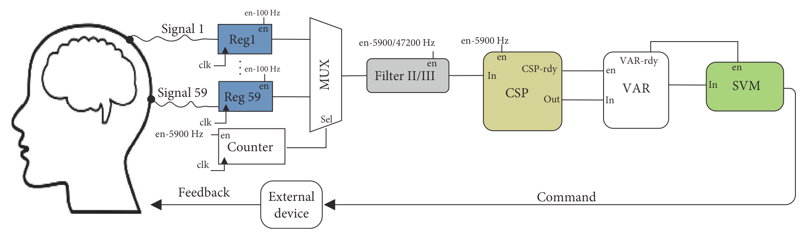
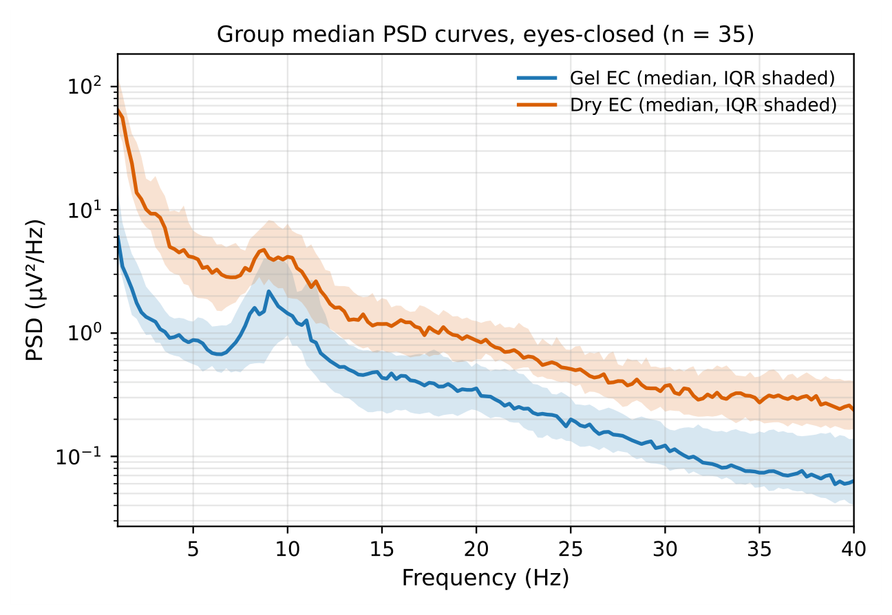
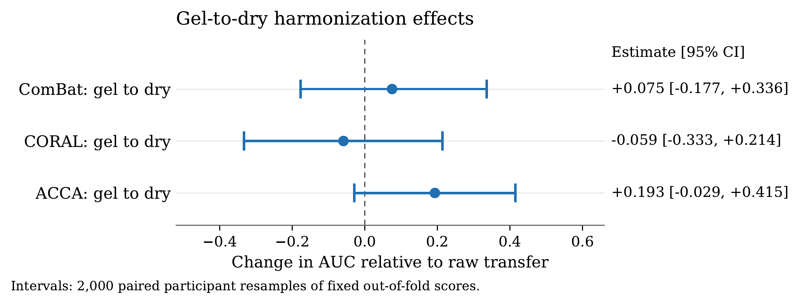
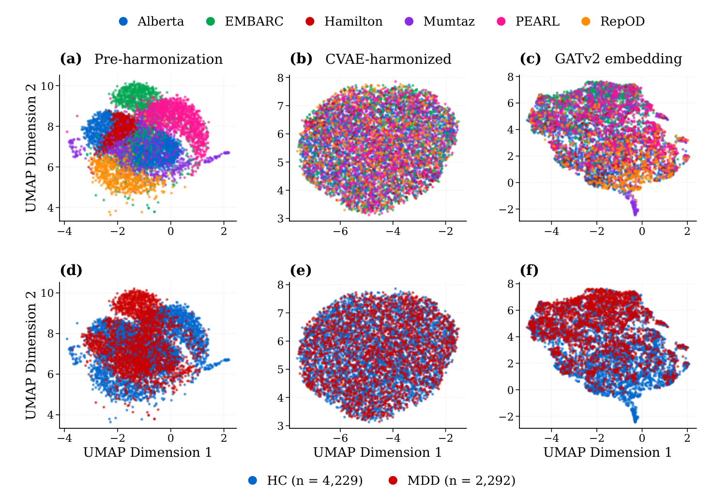
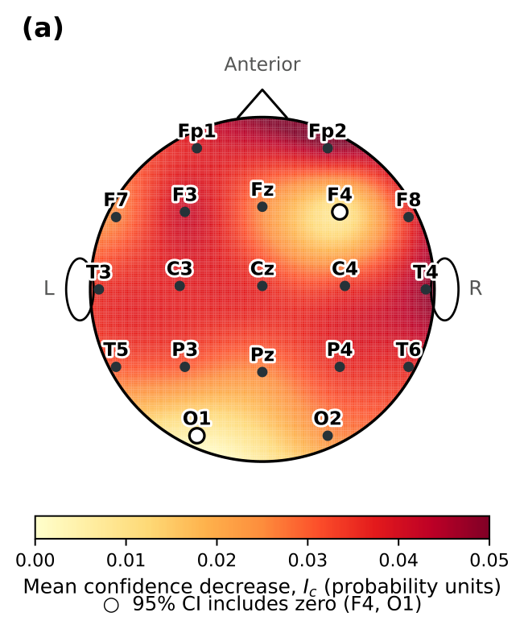
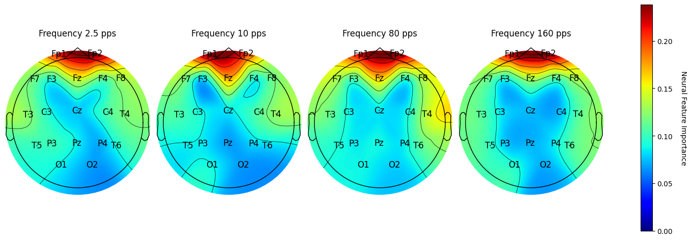

# EEG and brain–computer interface research

I’m **Tahereh Vasei**, a PhD candidate in Electrical Engineering at New York Institute of Technology. I build EEG decoders and study what happens to their predictions when the hardware or the people being measured change. My work spans fixed-point signal processing, paired headset experiments, and learning across clinical cohorts.

[Wearable motor imagery](projects/motor_imagery_bci/) · [Dry and gel electrodes](projects/dry_gel_harmonization/) · [Multi-cohort EEG](projects/cvae_gatv2/) · [Saliency maps for TEAS](projects/teas_eegnet/)

## A wearable motor-imagery decoder

I took a two-class motor-imagery decoder from signal-processing design to an FPGA prototype. One filter processes the channels in turn, with each channel’s state kept in RAM. The design reached **77.4% offline classification accuracy** across seven participants. The most compact implementation occupied **0.25 mm² at 4 mW** in 45 nm CMOS synthesis.

*Figure 17, Vasei et al., IET Computers & Digital Techniques (2024). The diagram shows the proposed signal path. The evaluation used recorded EEG and FPGA prototyping.*

[Read the hardware study](projects/motor_imagery_bci/) · [Published paper](https://doi.org/10.1049/2024/5596468)

## Can a gel-trained model work with dry electrodes?

The same 35 people wore both headsets. Their spectra had a median within-person correlation of **0.932**, yet a classifier could identify the headset with **0.999 ROC AUC**. For a clinical EEG classification task, asymmetric alignment raised gel-to-dry transfer AUC from **0.549 to 0.742**. Reversing the transfer direction produced a **0.078 decrease** in AUC.

*Median eyes-closed power spectra for the two headsets. Shading spans the interquartile range across participants.*

*Change in AUC relative to raw gel-to-dry transfer. Intervals are paired participant-bootstrap 95% intervals.*

[Read the paired-headset study](projects/dry_gel_harmonization/)

## Reference-conditioned CVAE harmonization for multi-cohort EEG classification

I trained a conditional variational autoencoder to reconstruct EEG under a common cohort condition, then used a graph attention network to classify major depressive disorder. The study covered **817 participants in six cohorts**. Among the **403 held-out participants from the two cohorts containing both classes**, balanced accuracy increased from **67.3% to 77.7%**.

*Representations at three stages. The same observations are colored by source cohort (top) and by diagnosis (bottom); after harmonization the cohorts mix while the diagnosis structure remains.*

*Electrode occlusion: the mean decrease in classifier confidence when each electrode's input is masked.*

[Read the modeling study](projects/cvae_gatv2/)

## Where does the model look?

In a published study of brain responses to transcutaneous electroacupuncture stimulation (TEAS), EEGNet decoded the stimulation phases of 48 participants with accuracies above 92%. I used saliency maps to ask which electrodes the network relied on. The importance concentrated on seven frontal and temporal electrodes (Fp1, Fp2, Fz, F7, F8, T3, T4), and a classifier retrained on those seven alone performed close to the full 19-electrode montage.

*Figure 5, Vasei et al., Algorithms (2024). Aggregated saliency for each stimulation frequency; warmer colors indicate higher electrode importance.*

[Read the saliency study](projects/teas_eegnet/) · [Published paper](https://doi.org/10.3390/a17110477) · [Inspect the maps](assets/figures/teas-saliency.png)

---

[Figure credits](assets/FIGURES.md) · [GitHub profile](https://github.com/Tvasei)
