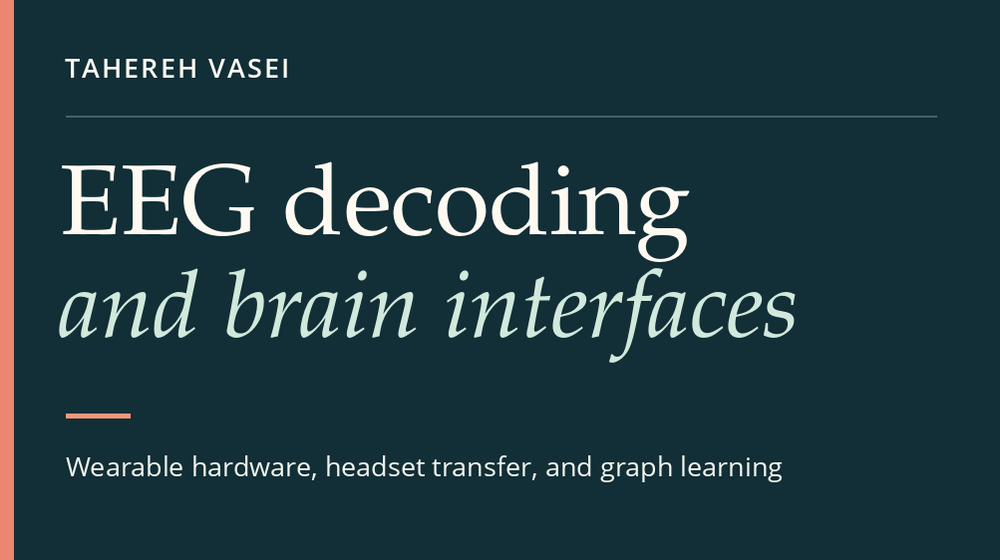

# EEG and brain–computer interface research

I’m **Tahereh Vasei**, a PhD candidate in Electrical Engineering at New York Institute of Technology. I build EEG decoders and study what happens to their predictions when the hardware or the people being measured change. My work spans fixed-point signal processing, paired headset experiments, and learning across clinical cohorts.

[Wearable motor imagery](projects/motor_imagery_bci/) · [Dry and gel electrodes](projects/dry_gel_harmonization/) · [Multi-cohort EEG](projects/cvae_gatv2/)

## A wearable motor-imagery decoder

I took a two-class motor-imagery decoder from signal-processing design to an FPGA prototype. One filter processes the channels in turn, with each channel’s state kept in RAM. The design reached **77.4% offline classification accuracy** across seven participants. The most compact implementation occupied **0.25 mm² at 4 mW** in 45 nm CMOS synthesis.

*Figure 17, Vasei et al., IET Computers & Digital Techniques (2024). The diagram shows the proposed signal path. The evaluation used recorded EEG and FPGA prototyping.*

[Read the hardware study](projects/motor_imagery_bci/) · [Published paper](https://doi.org/10.1049/2024/5596468)

## Can a gel-trained model work with dry electrodes?

The same 35 people wore both headsets. Their spectra had a median within-person correlation of **0.932**, yet a classifier could identify the headset with **0.999 ROC AUC**. For a clinical EEG classification task, asymmetric alignment raised gel-to-dry transfer AUC from **0.549 to 0.742**. Reversing the transfer direction produced a **0.078 decrease** in AUC.

[Read the paired-headset study](projects/dry_gel_harmonization/) · [Compare the spectra](assets/figures/dry-gel-spectra.png) · [See the gel-to-dry effects](assets/figures/dry-gel-transfer.png)

## Which EEG features carry across cohorts?

I trained a conditional variational autoencoder to reconstruct EEG under a common cohort condition, then used a graph attention network to classify major depressive disorder. The study covered **817 participants in six cohorts**. Among the **403 held-out participants from the two cohorts containing both classes**, balanced accuracy increased from **67.3% to 77.7%**.

[Read the modeling study](projects/cvae_gatv2/) · [Inspect the embeddings](assets/figures/cvae-umap.png)

---

[Figure credits](assets/FIGURES.md) · [GitHub profile](https://github.com/Tvasei)
