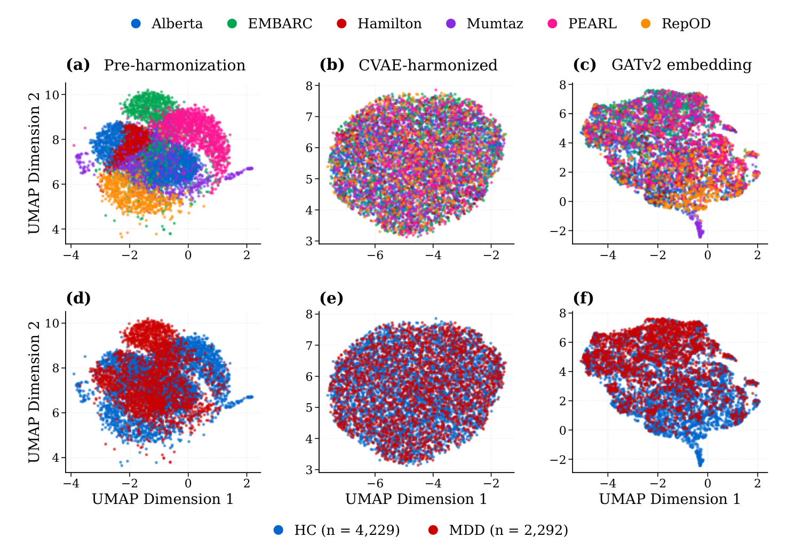
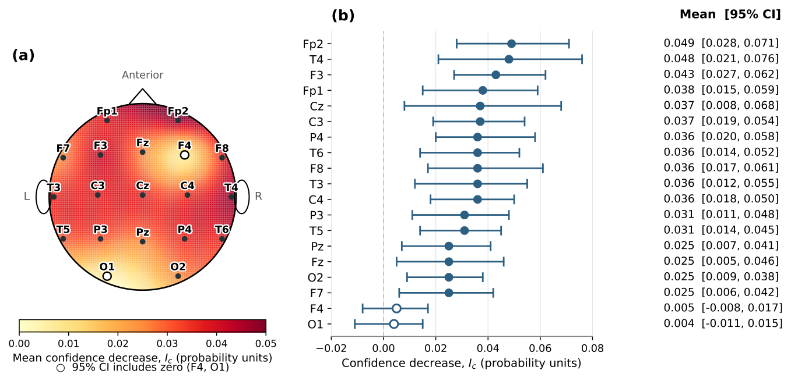

[← Research portfolio](../../README.md)

# Learning across EEG cohorts with a CVAE and graph attention

**Tahereh Vasei, Maryam Ravan, and Gary Hasey** · Revised manuscript under review, *Biomedical Signal Processing and Control*

When recordings come from different studies, a classifier can recognize the recording cohort and use that information as a shortcut. I built a conditional variational autoencoder (CVAE) to harmonize EEG recordings and a graph attention classifier (GATv2) to test whether the transformed signals still carried information about major depressive disorder.

*Manuscript Figure 2. Each dot is one of 6,521 observations from 164 people in this visualization. Colors identify cohort in the top row and diagnosis in the bottom row. The plots are qualitative. The classification metrics below use the full primary evaluation set.*

## Study design

The study included **817 participants** across **six cohorts**, contributing **32,987 non-overlapping five-second EEG segments**. The primary classification comparison covered **403 participants** from the Alberta and Mumtaz cohorts, which each included both depression and healthy-control groups. Participants were kept separate between training and evaluation.

The CVAE reconstructs segments using a common reference-cohort condition. For each reconstructed segment, I represented electrodes as graph nodes and connected them using a directed phase lag index (dPLI). The GATv2 classifier used these graphs for the depression classification task.

## Two tests of the harmonization

| Downstream classification in the two mixed-class cohorts | Balanced accuracy | Matthews correlation coefficient |
| :--- | ---: | ---: |
| Original EEG | 67.3% | 0.368 |
| Signal-level ComBat | 51.4% | 0.033 |
| Reference-conditioned CVAE | **77.7%** | **0.530** |

I also tested whether a separate classifier could still identify the source cohort after reconstruction. The revised manuscript reports source-cohort balanced accuracy of **99.4%** on the original signals, **77.3%** with shuffled cohort conditioning, and **31.0%** with the true conditioning. Residual cohort information remained. The evaluation covered new people within the represented cohorts. Transfer to a new site would require a separate test.

*Electrode occlusion. Masking one electrode at a time measures model sensitivity. The intervals quantify variation across resampled participants. The scalp layout shows electrode positions.*

## Reproducibility

Reproducing the reported table would require the original training pipeline, the frozen CVAE checkpoint, and the study data. Those artifacts are outside this release.

[Figure credits](../../assets/FIGURES.md) · [Back to the portfolio](../../README.md)
