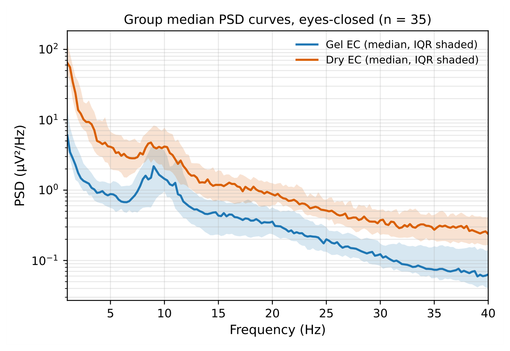
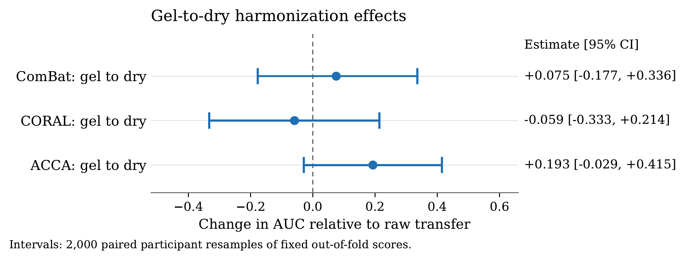

[← Research portfolio](../../README.md)

# Does an EEG classifier transfer from gel to dry electrodes?

**Tahereh Vasei, Maryam Ravan, and Gary Hasey** · Research manuscript

If two headsets record a similar spectrum from the same person, can a model trained on one headset use the other? I designed and implemented a paired analysis to measure what changed between devices and how those changes affected classification.

*Manuscript Figure 2. Both devices capture a peak near 10 Hz. The dry headset records higher median power across the plotted frequencies.*

## Study design

Thirty-five participants with mood disorders completed same-day, eyes-closed EEG recordings with both systems. I resampled the signals to 200 Hz and compared 316 spectral, temporal, nonlinear, and connectivity features across 19 channels. Past-month suicidal ideation was the binary outcome for the transfer experiment.

For each held-out participant, I fitted harmonization on the remaining pairs, then evaluated the gel-trained classifier on that participant’s dry recording. I compared unaligned transfer with feature harmonization using ComBat, covariance alignment (CORAL), and an asymmetric method combining ComBat with block-wise covariance alignment (ACCA). The gel system provided the reference.

## What changed across headsets

| Question | Measurement in the paired cohort |
| :--- | :--- |
| Did the two recordings have similar spectra? | Median within-person log-spectrum correlation **0.932** |
| Could a model distinguish the devices? | Device classification ROC AUC **0.999** |
| Did individual features agree? | Median intraclass correlation **0.141** |
| How well did the gel-trained classifier transfer? | ROC AUC **0.549** without alignment and **0.742** with ACCA |

The aligned transfer AUC had a 95% confidence interval of **0.558–0.905**. High spectral agreement coexisted with a device signature strong enough for near-perfect device classification. Evaluating the clinical task on held-out people revealed the practical consequence of that signature.

*Manuscript Figure 4. ACCA improved gel-to-dry AUC by 0.193. In the opposite direction the change was −0.078. Bars give paired bootstrap intervals for each change.*

The comparison covers one pair of headsets and 35 people. The size of the transfer gain is uncertain, and external cohorts would be needed to establish clinical performance. This page presents aggregate manuscript results. Participant-level recordings are restricted.

[Figure credits](../../assets/FIGURES.md) · [Back to the portfolio](../../README.md)
