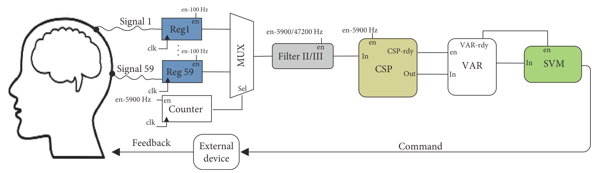
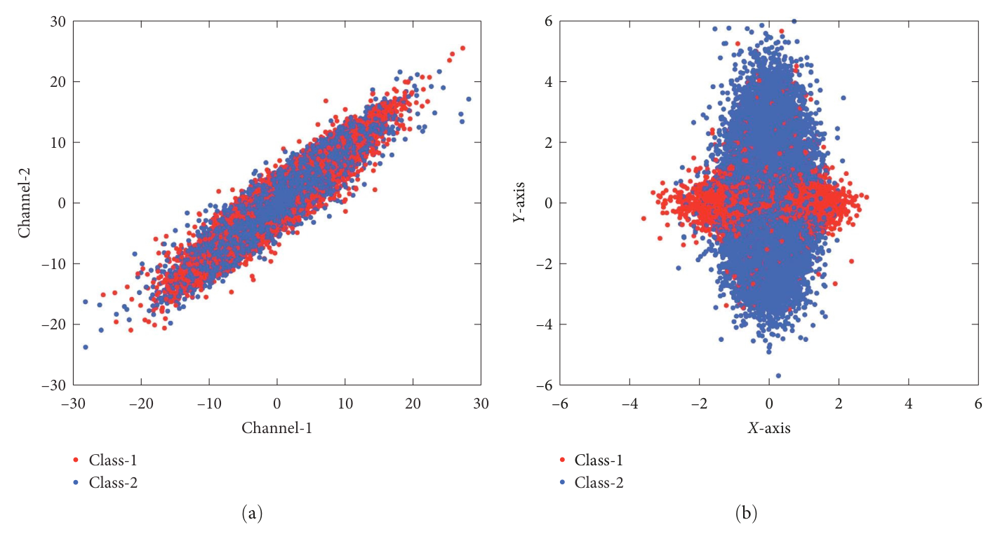

[← Research portfolio](../../README.md)

# Motor imagery on a wearable EEG processor

**Tahereh Vasei, Mohammad Ali Saber, Alireza Nahvy, and Zainalabedin Navabi** · *IET Computers & Digital Techniques*, 2024 · [Open paper](https://doi.org/10.1049/2024/5596468)

For my master’s research at the University of Tehran, I designed a fixed-point EEG decoder and prototyped it on a Xilinx Virtex-7 FPGA. The engineering question was how much circuitry a decoder could reuse while still processing each sample in time for the next one.

*Figure 17 from the published paper shows the signal path for Designs II and III. The external-device loop is part of the proposed architecture.*

## From EEG samples to an RTL design

The decoder filters EEG at 8–30 Hz, projects the channels onto common spatial patterns (CSP), and tracks the variance of those projections. A linear support vector machine classifies the resulting features. Training happens offline, so the hardware needs only the fitted coefficients for inference.

I used the interval between EEG samples to share a filter across channels. A RAM-based design stores each channel’s filter state and retrieves it when the next sample arrives. This reduces the number of arithmetic units at the cost of additional clock cycles. The paper compares three implementations of this trade-off.

*Figure 6 shows how the spatial projection changes the geometry of the two classes. The points illustrate the transformation. The accuracy below summarizes five-fold cross-validation.*

[Inspect the RAM-based filter circuit in Figure 12](../../assets/figures/bci-filter-bank.png)

## Evaluation

| Evaluation | Reported result |
| :--- | :--- |
| Two-class motor imagery, seven participants, five-fold cross-validation | **77.4% average accuracy**, 75.1% sensitivity, 79.8% specificity |
| 45 nm CMOS synthesis | **4 mW** and **0.25 mm²** |
| Virtex-7 FPGA prototype | **6 μJ** of energy and **1.52%** device utilization reported in the paper |

The accuracy comes from offline benchmark recordings. The timing, power, and area estimates characterize the implementation. Live prosthetic control remains a separate experimental question.

[Figure credits](../../assets/FIGURES.md) · [Back to the portfolio](../../README.md)
